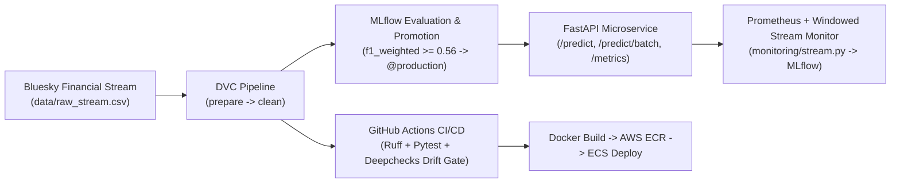

# Real-Time Financial News Sentiment MLOps Pipeline & Monitoring Service

End-to-end MLOps pipeline and production inference microservice for real-time financial market headline sentiment analysis (`baptle/FinBERT_market_based`), integrating **DVC** reproducible data pipelines, **MLflow** experiment tracking & gated registry promotion, **FastAPI + Prometheus** observability, **Deepchecks NLP** drift gates in GitHub Actions, and containerized **AWS ECR / ECS Fargate** deployment.

---

## End-to-End MLOps Architecture



---

## Core Capabilities

- **Reproducible Data Versioning (`dvc.yaml`, `dvc.lock`, `params.yaml`)**: Deterministic `prepare` and `clean` stages transforming raw streaming market headlines into deduplicated `train.csv` and `test.csv` splits.
- **Gated MLflow Model Promotion (`scripts/evaluate.py`, `scripts/promote.py`)**: Computes accuracy, precision, recall, and weighted F1 on held-out financial headlines, registering `finbert` in MLflow and assigning the `@production` alias only when `f1_weighted >= 0.56`.
- **Instrumented FastAPI Service (`app/main.py`)**: Serves single (`POST /predict`) and batched (`POST /predict/batch`) FinBERT sentiment predictions with UTC structured JSON logs and native Prometheus metrics (`prediction_requests_total`, `prediction_latency_ms`, `prediction_errors_total`).
- **Automated NLP Drift CI Gates (`.github/workflows/ci-cd.yml`, `scripts/run_deepchecks.py`)**: Blocks container promotion if Deepchecks NLP `PropertyDrift` (`> 0.50`) or `PredictionDrift` (`> 0.60`) thresholds breach prior to ECR push and ECS task rollout.
- **Production Stream Telemetry (`monitoring/stream.py`)**: Sliding 50-headline window (`WINDOW_SIZE = 50`) tracking class distribution shifts, mean confidence, and P50/mean latency in MLflow.

---

## Quick Start

```bash
python3 -m venv .venv
source .venv/bin/activate
pip install -r requirements.txt

# Reproduce DVC data preparation & cleaning stages
dvc repro

# Run unit & API integration tests
pytest tests/ -v

# Run Deepchecks NLP property & prediction drift gate
python scripts/run_deepchecks.py

# Launch FastAPI + MLflow + Prometheus stack via Docker Compose
docker compose up --build
```

## License

MIT License — see [LICENSE](LICENSE).
