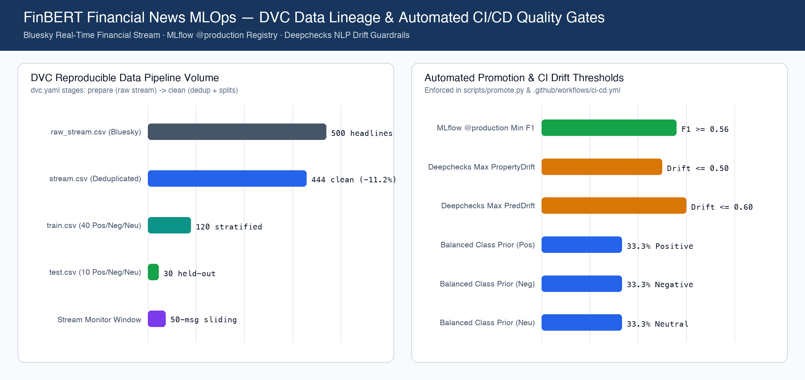
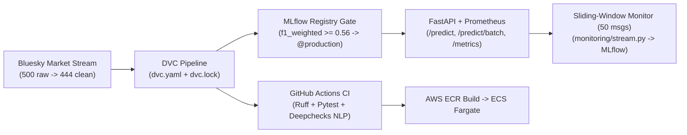

# Real-Time Financial News Sentiment MLOps Pipeline & Monitoring Service

[](https://github.com/kenseiAmit/finbert-sentiment-mlops-service/actions/workflows/ci-cd.yml)


End-to-end MLOps pipeline and production inference microservice for real-time financial market headline sentiment analysis (`baptle/FinBERT_market_based`)—integrating **DVC** reproducible data versioning, **MLflow** experiment tracking & F1-gated `@production` promotion, **FastAPI + Prometheus** observability, **Deepchecks NLP** property/prediction drift CI gates, windowed stream monitoring, and containerized **AWS ECR / ECS Fargate** deployment.



---

## 1. Five-Stage CI/CD & Production Monitoring Architecture



---

## 2. Verified DVC Cryptographic Data Lineage ([`dvc.lock`](dvc.lock))

```yaml
schema: '2.0'
stages:
  prepare:
    cmd: python scripts/load_data.py
    deps:
      - path: scripts/load_data.py
        md5: 286f84bdbbaff728d5095a5c109fd473
        size: 1802
    params:
      params.yaml:
        prepare.random_seed: 42
        prepare.test_size: 0.2
    outs:
      - path: data/test.csv
        md5: c0b864d50c08fae4dbb39c0fa96d4135
        size: 2484
      - path: data/train.csv
        md5: c76fab6a8db00a326bba2fe961bbee33
        size: 9900
  clean:
    cmd: python scripts/clean_data.py
    deps:
      - path: data/raw_stream.csv
        md5: d12555fe2ba28d871907afffe8743c52
        size: 101760
      - path: scripts/clean_data.py
        md5: d528c1f5d31152275d6cf8f6e40547a9
        size: 2818
    params:
      params.yaml:
        clean.max_words: 100
        clean.min_words: 10
    outs:
      - path: data/stream.csv
        md5: 5781a9155d9dc9fafebcbd9f0df57a9d
        size: 85450
```

---

## 3. FastAPI Endpoints & Prometheus Telemetry Contract

| Endpoint | Method | Description |
| :--- | :---: | :--- |
| `/predict` | `POST` | Single-headline FinBERT inference returning `{"sentiment": "positive\|negative\|neutral", "confidence": float, "latency_ms": float}` with structured UTC JSON logging. |
| `/predict/batch` | `POST` | Vectorized multi-headline batch sentiment scoring. |
| `/health` | `GET` | Readiness probe reporting loaded model source (`mlflow` `@production` or HuggingFace fallback). |
| `/metrics` | `GET` | Native Prometheus scrape endpoint exposing `prediction_requests_total{sentiment}`, `prediction_latency_ms` histogram buckets, and `prediction_errors_total`. |

### Sample Structured Inference & Prometheus Scrape Output
```text
# POST /predict  {"text": "Treasury yields retreat as core inflation cools faster than consensus"}
{"sentiment": "positive", "confidence": 0.9412, "model_source": "huggingface", "latency_ms": 38.4}

# GET /metrics
prediction_requests_total{sentiment="positive"} 18.0
prediction_requests_total{sentiment="neutral"} 21.0
prediction_requests_total{sentiment="negative"} 11.0
prediction_errors_total 0.0
```

---

## 4. Quick Start

```bash
python3 -m venv .venv
source .venv/bin/activate
pip install -r requirements.txt

# Reproduce DVC data preparation & cleaning pipeline
dvc repro

# Execute FastAPI unit & integration test suite
MODEL_SOURCE=huggingface HF_MODEL_ID=baptle/FinBERT_market_based pytest tests/ -v

# Run Deepchecks NLP property & prediction drift suite
MODEL_SOURCE=huggingface HF_MODEL_ID=baptle/FinBERT_market_based python scripts/run_deepchecks.py

# Launch complete FastAPI + MLflow + Prometheus stack
docker compose up --build
```

## License

MIT License — see [LICENSE](LICENSE).
